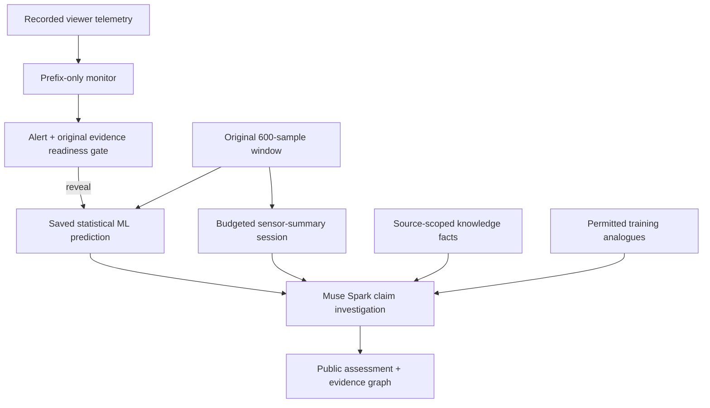

# PetroMind

**A statistical model proposes a fault. Meta Muse Spark investigates what the evidence actually establishes.**

Industrial measurements can look similar for different failures. PetroMind helps an
engineer separate a plausible classifier prediction from an explanation the
available evidence actually supports.

**Watch the complete story:** recorded telemetry → pressure alert → statistical
hypothesis → Muse Spark tool investigation → traceable findings and uncertainty.
The Demo's guided actions navigate the recorded alert and original diagnosis
checkpoint. They never add sensor evidence or make a model call. Muse's received
measurements, documented context, historical comparisons, and accepted public
findings remain inspectable. Replay and paid live execution are clearly labeled.

## Run the hackathon demo

For the preferred judge replay, [verify and import the completed saved v5 run](docs/saved-v5-replay.md).
This uses no API calls and keeps the original frozen recording available.

Use Python 3.12 and the original authorized local claim capture and monitoring
bundle. These artifacts and the 3W dataset are **not bundled in the public repo**.
A fresh clone alone cannot replay these incidents. If `viewer.json` is missing,
follow the [complete setup/export commands](docs/hackathon-readiness.md) first.

```bash
python -m pip install -e '.[test,agent,audit]'
python scripts/demo_claim_audit.py check \
  --capture .petromind/claim-audit-v1 \
  --monitoring .petromind/monitoring-demo-v1
python scripts/demo_claim_audit.py serve \
  --capture .petromind/claim-audit-v1 \
  --dataset ../3W/dataset \
  --science-protocol .petromind/science-m5-v1/protocol.json \
  --monitoring .petromind/monitoring-demo-v1
```

Open **http://127.0.0.1:8765/demo**. These commands make no paid calls. Start at the
first sample; alerts are computed from the observed prefix, and the original
600-sample classifier window must finish before diagnosis is revealed. Use **Jump to recorded alert**, then **Continue to classifier** (when a monitoring
bundle is loaded). Review the four handoff cards, choose the investigation mode,
and click **Investigate with Muse Spark** to watch genuine captured records unfold
automatically. Inspect
the returned source facts, historical overlap, public findings and missing premise.

[Readiness runbook and one-run live smoke commands](docs/hackathon-readiness.md) ·
[Three-minute judge script](docs/hackathon-demo.md) ·
[Submission description](docs/hackathon-submission.md) ·
[Verification receipt](docs/readiness-verification.md) ·
[Visual Technology walkthrough and browser checks](docs/technology-page.md) ·
[Classifier-to-Muse handoff](docs/classifier-handoff.md)

Live v3 can request additional source-motivated summaries within the shared five-
sensor budget; it requires verified original raw windows, a fresh capped protocol,
server-side `MODEL_API_KEY` and an explicit paid action. No paid readiness call was
run here. The supported deployment is a trusted **local Python process**, not a
static site or a validated public multi-user service. Do not disable loopback,
Host/Origin/token or spending protections to publish it.

For the full judge walkthrough, current verification limits, and submission
checklist, see [final sprint readiness](docs/hackathon-completion.md).
[Architecture](docs/architecture.md) · [Video plan](docs/hackathon-demo.md) ·
[Project description](docs/hackathon-submission.md) ·
[Official requirements checked November 2](docs/submission-checklist.md).

## Architecture and evidence boundary



The viewer's broader raw playback never enters the agent packet. Optional new
queries use the original verified window. The diagram shows software data flow,
not physical equipment topology. Classification is retrospective, not an online
prediction moved to the alert time. Graph lookup returns vetted topic facts,
not discovery of a particular well's installed piping.

## Actual evidence and limits

The frozen 33-incident study reported adaptive **20/33 (60.6%)**, fixed **13/33
(39.4%)**, Muse sensor-only **4/33 (12.1%)**, graph **1/33 (3.0%)**, GraphRAG **5/33
(15.2%)**. No GraphRAG classification advantage was demonstrated. Small claim-audit
pilots are correlated constructed claims over actual telemetry, not general
physical validation. Correct numbers/citations do not certify root cause.

The two annotation-centered monitoring clips are a demonstration, not a blinded
alarm benchmark. The first rule alert substantially predates the annotation; do
not claim verified early fault detection. No statistically validated alarm
performance, active-selection benefit or independent engineering certification
is established. PetroMind is decision support, not an autonomous controller.

New interactive live protocols suppress historical training-event labels under
`training-history-label-free-v1`. Frozen captures retain their original training
labels (never hidden target labels), so replay is explicitly **not retroactively
label-free**. See the receipt for this preserved-record exception.

## Earlier frameworks and experiments

The following sections preserve reproducible research tooling; they are not
additional instructions to expand evaluation before the submission.

Milestone 1: a tested, label-blinded investigation framework for industrial
fault diagnosis with a maximum of **five unique sensor queries**. An optional
Milestone 2 Muse Spark tool runner is also available (see below).

Milestone 3 adds explicit sensor-quality metadata and the [paired evaluation
workflow](docs/evaluation.md): freeze the original 33-case cohort, run a small
pilot across three Muse variants plus fixed/adaptive baselines, then resume the
same protocol for the full cohort. No GraphRAG improvement is assumed.

## Setup and demonstration

Use Python 3.10 or newer (the previous prototype used 3.9; upgrade the venv):

```bash
python -m venv .venv
source .venv/bin/activate
python -m pip install -e '.[test,experiments]'
python -m pytest -q
python scripts/demo_investigation.py --dataset ../3W/dataset --budget 5
```

Clone/download the [Petrobras 3W dataset](https://github.com/petrobras/3W)
separately. Point `--dataset` at the directory containing numbered event folders
and real `WELL-*.parquet` files. No dataset is bundled or redistributed. Consult
the dataset's current license and citation requirements before redistribution.

The CLI emits JSON lines for public sensor names, sensor summaries, illustrative
graph traversals, training-case analogues, remaining budget, a final structured
diagnosis, and the audit digest. It automatically chooses the first eligible
held-out incident in deterministic file order, without selecting by diagnostic
success. Ground truth is hidden unless the separate evaluator is requested:

```bash
python scripts/demo_investigation.py --dataset ../3W/dataset --budget 5 --reveal
```

This is a **scripted tool demonstration**, not an LLM agent or a performance
claim. It tries P-TPT, generic associated sensors, then the remaining public
catalog, and votes over up to three nearest training analogues. Confidence is
explicitly uncalibrated and set to 0.0. If no valid readings or historical
overlap are observed, it fails with exit code 2 instead of inventing a diagnosis.

The default split is frozen at `.petromind/split.json`. It contains evaluator-only
well identifiers. Reuse it for every policy and budget in the future evaluation
runner. Use `--split path/to/split.json --seed 42` for an explicit protocol;
existing manifests reject a different seed or well universe. No class labels
are used to choose the split. Rare classes can be absent in either partition;
report coverage when scoring. Do not retry seeds based on test performance.

The original `python demo.py --dataset ... --incident ... --budget 5` entry point
still works, with the same framework. An explicit incident must already belong
to the frozen test partition; otherwise it is rejected. There is no target-well
exception to the split.

## Modules and contracts

| Module | Responsibility |
| --- | --- |
| `petromind/session.py` | `DiagnosticSession`, five registered tools, validation, caching, sealing, thread-safe accounting |
| `petromind/audit.py` | Frozen audit entries, immutable snapshots, hash-chain verification |
| `petromind/measurements.py` | Deterministic finite numeric summaries and cleaning counts |
| `petromind/equipment.py` | Typed sensor/equipment nodes and provenance-bearing relationships |
| `petromind/retrieval.py` | Explicit training-well index; observed-sensor-only similarity |
| `petromind/splits.py` | Immutable seeded well partition and versioned JSON manifest |
| `petromind/data.py` | Trusted Parquet loading and transient-window extraction |
| `petromind/pipeline.py` | Shared split, training catalog/index, session/evaluator composition |
| `petromind/evaluation.py` | Separate evaluator that refuses reveal before submission |

Register **only** `session.dispatch(tool_name, arguments)` with the future agent.
It accepts these tools and rejects unknown names/extra arguments:

| Tool | Arguments | Behavior |
| --- | --- | --- |
| `list_sensors` | `{}` | Public training-derived catalog; no target availability information |
| `get_sensor_history` | `sensor_name` | Bounded numeric summary; new sensor costs 1, cache hit costs 0 |
| `get_equipment_neighbors` | `sensor_name` | Generic associations with verification/provenance; up to 20 calls |
| `search_similar_incidents` | optional `top_k` (1–10) | Up to 10 searches; only previously queried sensor summaries |
| `submit_diagnosis` | `predicted_fault_type`, `confidence`, `evidence` | Fault integer 1–9, finite confidence 0–1, nonempty unique list of observed available sensor names |

Missing, absent, nonnumeric, infinite and extreme readings still cost one query.
Repeated requests return cached summaries even after the budget is exhausted.
Unknown sensors cost no sensor query and are audited with sanitized arguments.
The configured sensor budget must be an integer from 1 through 5. Graph/search
calls do not reveal measurements or consume sensor budget; separate quotas and
audit entries make their use explicit. The graph query can mention adjacent
public sensor names before they are measured, without revealing availability.

Submission includes the cited summaries and closes the investigation. Every
subsequent tool call is rejected and audited. Both cached and failed queries are
recorded. Audit snapshots and observations cannot be mutated by callers; audit
entries contain canonical JSON strings and a chained SHA-256 digest. The chain
detects accidental changes but is in-memory, unsigned and not durable external
tamper-proof storage. Persist traces to a trusted sink in a later milestone.

## Security and evaluation boundary

The trusted loader may inspect labels to locate a complete 600-second window
starting at known transient onset. It requires contiguous labels 101–109 and
ordered 1 Hz timestamps. NA labels are never treated as normal. Class/state,
timestamps, filenames, paths and arbitrary metadata are stripped before the
session is constructed. The session receives a deep copy of whitelisted sensor
columns and a random case ID independent of the event/well. Target-only sensor
columns are excluded: the public catalog is derived solely from training data.

The retriever is built from an explicit training partition and **rejects** any
supplied test/unknown well. Its results expose training fault types (allowed
historical labels), opaque random case IDs, distance and shared sensor names;
they expose no source paths, well IDs or unobserved historical measurements.
The prototype's bounded median-distance metric is retained, uses no test-fitted
statistics and is not a calibrated probability. No retrieval runs before an
available measurement is observed.

`PreparedInvestigation` and `Evaluator` are trusted runner objects. Give the
agent only serialized tool responses; never give it this bundle, a session
object, Python execution, filesystem access, debug output, or loader/evaluator
capabilities. Python privacy is **not a sandbox** against arbitrary local code
or reflection. A future remote model executor must preserve this tool-only
boundary and bound its total turn count. `Evaluator.reveal(session)` checks case
binding, finalized submission, and the audit chain; it is not a registered tool.

All generic graph edges are currently **illustrative assumptions inherited from
the prototype**, with explicit provenance pointing to commit `baf1fd0`. The graph
models associations, not directional fluid flow, causal relationships, or exact
per-well equipment. There are no independently verified physical edges yet.

The `|x| > 1e12` raw-value cutoff is a transparent **numerical heuristic**, not
an engineering range check. Summaries report invalid/missing counts, JSON nulls
instead of NaN, and population standard deviation. Sensor-specific engineering
ranges and verified physical edges require sourced follow-up work.

## Tests, experiments and provenance

Tests use explicitly fabricated time series and temporary Parquet files. They
cover budget/cache/concurrency, invalid inputs, missing/extreme values, immutable
audits, hidden metadata, group holdout, retrieval evidence gating, finalized
submission, separate evaluation, and subprocess CLI runs. They make no claims
about real 3W performance. GitHub Actions runs the suite on Python 3.10 and 3.12.

`first10.py`, `ablation.py` and `active_sensors.py` are unchanged exploratory
baselines. Install the `experiments` extra for their original commands. They
retain their historical split protocols/results; they have **not** been silently
migrated or re-evaluated under the new split. All new comparison runners must
use `WellSplit` / `prepare_investigation` for paired evaluation. No fine-tuning,
dataset, credentials, or industrial control actions are included. Muse API calls
are opt-in through the separate runner below; the original demo stays scripted.

The initial repository commit contains preparatory experiments described in the
handoff; its October 27 commit timestamp does not establish when that code was
originally developed. This feature adds the session, evaluator, shared split,
retrieval safeguards, typed graph metadata, tests and CLI. Contest eligibility
must distinguish this contribution from pre-existing prototypes. No eligibility
claim is made here.

### Compatibility changes required for isolation

`graph_tools.py` retains `clean`, `summarize`, `well_id`, `make_graph`, the
`Investigation(path, budget, seconds)` factory and imports for the new classes.
The factory returns a hardened `DiagnosticSession`; use `prepare_investigation`
when you need the separate evaluator or custom split. Its old public path/label
attributes and `.evaluate()` method are removed. `IncidentRetriever` now takes
training incident records plus an explicit `WellSplit`; the unsafe constructor
that accepted just a root and target-well exclusion is intentionally removed.

## Milestone 2: Muse Spark tool investigation

The optional runner lets Muse select sensor/graph/retrieval calls and submit a
diagnosis through the existing Python-enforced session. It does not automatically
select sensors or substitute a scripted diagnosis when the model fails. The
Milestone 1 CLI and the three exploratory scripts keep their behavior.

Install in your Python 3.10+ environment:

```bash
python -m pip install -e '.[test,agent,experiments]'
python -m pytest -q
```

Create a key in the [Meta developer dashboard](https://dev.meta.ai/). In zsh, load
it without putting the secret in a command or shell history:

```zsh
read -rs 'MODEL_API_KEY?Paste your Meta API key: '
echo
export MODEL_API_KEY
```

If you already exported the key for the API smoke test, reuse that same terminal.
The runner reads `MODEL_API_KEY` from the environment; it does not load `.env`
automatically, accept a key as a CLI argument, or include it in trace files.

```bash
python scripts/demo_muse.py --dataset ../3W/dataset --budget 5 \
  --trace .petromind/muse-run-001.jsonl --reveal
```

The model receives constant public 3W fault names/sensor context and only the
label-blinded session tools. The default dataset case and frozen split are the
same as the scripted demo. It chooses its own measurements, may stop early, and
must cite available observed sensors when submitting. Confidence is the model's
subjective self-report, not a calibrated probability. A successful exit requires
an accepted `submit_diagnosis`; plain model text is not a submission.

`--reveal` runs the independent evaluator only after a successful submission.
Failures exit 2, report a static reason code and never reveal the target label.
The optional JSONL trace flushes each event immediately and refuses to overwrite
an existing file; use a fresh filename for subsequent runs. Trace output contains
tool arguments sanitized by the session, actual results, audit hashes, request
counts, reported token usage, model/configuration and prompt version/hash. Raw
assistant text, reasoning, opaque replay blobs, API keys, vendor error messages,
source filenames and source paths are excluded. A trace with `--reveal` has an
evaluation-only final record; never feed that record into a future investigation.

The integration follows Meta's [Responses protocol](https://dev.meta.ai/docs/protocols/responses)
and [tool calling](https://dev.meta.ai/docs/tool-calling) documentation. Requests
use `https://api.meta.ai/v1/responses`, `store: false`, and encrypted reasoning
replay; opaque reasoning items and assistant commentary phases are carried across
turns in memory, but never displayed/exported. Disabling response persistence
does not make a claim about broader provider logging or data-retention policy.
There are no built-in web, filesystem, code-execution or evaluator tools.

The public taxonomy/measurement context is attributed to Petrobras 3W 2.0.0,
[dataset.ini](https://github.com/petrobras/3W/blob/main/dataset/dataset.ini), source
blob `4c4799e80e04a9cf8b10cb3f9a23f1c487797cc9` (CC BY 4.0). Definitions and units
do not verify the illustrative graph edges or any particular well's topology.

Default safeguards: at most 20 model turns, 40 dispatched tool calls, 24 HTTP
attempts, 2 retries per request, 2,048 generated tokens per attempt (including
reasoning), and 40,960 conservatively reserved output tokens across attempts.
The transport reserves the entire per-attempt cap even for failures, rather than
assuming failed attempts were free. Input tokens and rates still affect actual
API charges; these bounds are not a dollar spend cap. Use your Meta account's
billing controls as well. The run deadline is 300 seconds, with per-operation
HTTP timeouts up to 60 seconds. Network timeout enforcement is best-effort; slow
responses are rejected before tools are executed if the run deadline has passed.
Responses and accumulated request payloads are also size-limited.

Only HTTP 429/500/502/503 are retried, with bounded backoff and `Retry-After`.
A requested delay above 30 seconds causes a safe stop instead of retrying early.
Authentication/billing/permission errors, timeouts and 504 are not blindly
retried. Redirects and environment proxy routing are disabled. Tune limits with
`--max-turns`, `--max-tool-calls`, `--max-requests`, `--max-retries`,
`--max-output-tokens`, `--output-budget`, `--reasoning`, `--timeout` and
`--run-timeout`. Increasing an output cap may require increasing the total
reservation budget too. The model ID can be set with `--model`.

Tests use mocked HTTP responses and fabricated Parquet fixtures, exercising the
full runner/CLI, replay, validation, limits, retries, refusal and failure paths.
No tests spend API credits. The user's authentication smoke test succeeded with
Muse Spark 1.3; a complete real-model tool investigation must still be run locally
to validate account-specific API behavior. No model accuracy gain is claimed.

## Hypothesis challenger feasibility (Milestone 4)

The isolated development experiment tests whether Muse can seek contradictory
evidence and SUPPORT, CHALLENGE, or declare INSUFFICIENT_EVIDENCE for a statistical
hypothesis, without replacing its prediction. Model and Muse share five sensor
queries. See [the protocol, pilot commands and predeclared decision gate](docs/milestone4.md)
and [the unchanged Milestone 3 offline findings](docs/milestone3-failure-analysis.md).
Live M4 feasibility is unestablished until real pilot results and expert review.

### Physical knowledge and offline grounding study

The optional source-backed knowledge layer and zero-API development comparisons
are described in [grounding-development.md](docs/grounding-development.md). The
short [evidence-coverage report](docs/physical-evidence-coverage.md) distinguishes
documented semantics, example signatures, unknown physics and actual v4 findings.
The existing investigation policies and assessment tools remain unchanged by
default. No new paid grounding evaluation is enabled.

### Milestone 5: grounded diagnostic test design

The [one-test feasibility study](docs/milestone5.md) compares conventional expected
information gain with Muse planning without/with source-backed physical context.
It precommits expectations before Python executes a sensor-budgeted test, then
checks numeric interpretation separately from physical inference. See the
[execution status and limitations](docs/milestone5-status.md). No live scientific
capability or improvement is claimed from offline/mock tests.

### Optional Extension page

**HOME | DEMO | EXTENSION | TECHNOLOGY**

Demo remains the historical Petrobras 3W experience. The separate **Extension**
page at `/extension` replays the verified synthetic hydraulic investigation with
its own before/after story and collapsed technical evidence. Keep the existing
`--synthetic-replay .petromind/PetroMind-Synthetic-Showcase` server argument.
No new API calls are made. See [setup and focused verification](docs/synthetic-investigation-demo.md).
