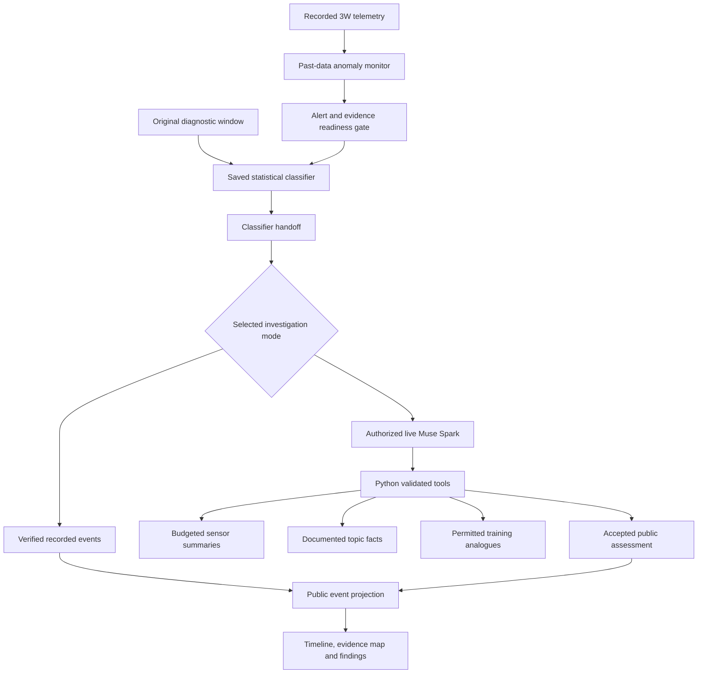

# PetroMind architecture

The implementation is a local Python server with a buildless HTML/CSS/JavaScript
frontend. This diagram is software flow, not physical piping or a causal model.

| Component | Actual responsibility |
| --- | --- |
| `monitoring_replay.py`, `causal_monitor.py` | Read the bounded recorded projection and compute deviation from previously observed data. A reference is not certified normal operation. |
| `replay_workflow.py`, frontend readiness gate | Reveal the saved classifier only after its original evidence is available. Guided jumps change viewer position, not detector/classifier logic. |
| `claim_demo.py` | Local HTTP app, separate replay/live modes, authentication/origin protections, bounded live execution. |
| `atomic_auditor.py`, `meta_api.py` | Existing v5 tools and submission contract; server-side API credentials, bounded repair and cost reservations. |
| `knowledge.py`, existing history tools | Source-scoped facts and training-only analogues. No verified per-well topology or causal graph traversal is claimed. |
| `saved_investigation.py`, `investigation_events.py` | Verify/import the supported saved run and project actual public records. Neither path rewrites accepted findings. |
| `web/app.js`, `web/investigation.js` | Present received evidence, citations, scoped findings and gaps. Viewer telemetry never becomes extra agent evidence by being displayed. |

Replay invokes no Meta endpoint. Live runs require an explicitly configured fresh
protocol and a paid user action; failures never silently switch to a recording.
The shared five-sensor budget counts inherited and requested summaries, including
unavailable queries. Source and citation validation do not certify physical truth.
