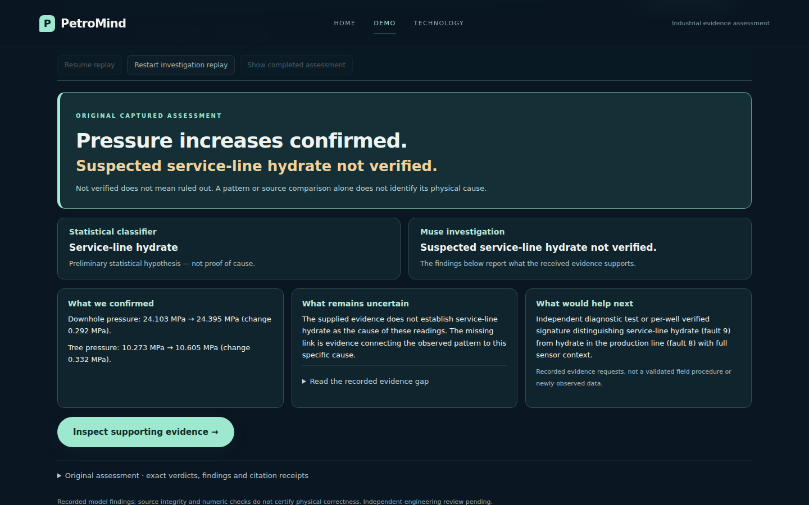
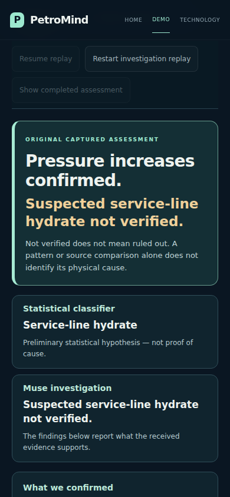

# Final findings: the investigation payoff

PR #37 now leads with a concise completion result instead of a repeated audit.
The genuine original hydrate capture presents:

> Pressure increases confirmed. Suspected service-line hydrate not verified.

This does not replace its recorded `PARTIALLY_SUPPORTED` verdict. The original
accepted public output, exact atomic verdicts, premises, missing evidence and
citation receipts remain available under **Original assessment**, including the
unchanged JSON. The result is a display projection, not a scientific regrading.

## What a judge sees

1. A prominent measurement conclusion and separate causal status.
2. Statistical classifier versus Muse investigation: prediction is distinguished
   from evidence support.
3. **What we confirmed**: supported, numerically matched observations and units.
4. **What remains uncertain**: a plain-language explanation with the exact recorded
   gaps expandable.
5. **What would help next**: the existing evidence request, with known fault names
   expanded for readability. No new sensor reading, procedure or recommendation
   is generated. Absence of a recorded request is stated explicitly.
6. **Inspect supporting evidence** opens the original timeline and evidence map
   below the result. The graph no longer competes with completion; focused nodes
   use the available full width and narrow full-graph layouts stack vertically.

## Conservative display rules

- No final conclusion is shown until a successful completion event follows an
  accepted `submit_audit` output. Receipt of an assessment alone is insufficient.
- Before completion, the submitted assessment is withheld from the timeline and
  graph presentation. The recorded event objects are unchanged.
- A pressure-rise headline requires supported measurement findings citing the
  received sensors **and** matching accepted numeric endpoints or delta. Otherwise
  the summary uses a generic scoped-claim headline, without inventing direction.
- Causal status is separate from overall verdict. Explicit causal findings retain
  their supported, contradicted or unestablished meanings. Legacy hypothesis gaps
  are summarized conservatively as unverified; legacy records without a separate
  causal finding say **No separate root-cause confirmation was recorded**.
- A supported documented example never becomes a supported causal conclusion.
  The second genuine capture confirms the pressure changes and source comparison
  while retaining the absence of separate root-cause confirmation.
- “Not verified” never means ruled out. Contradiction applies to the assessed claim,
  not automatic exclusion of every version of the fault. Model support does not
  constitute independent physical certification.
- Missing next evidence is reported as missing. Recorded test requests are not
  presented as validated field procedures.
- Failed/incomplete investigations do not display a completed result or silently
  substitute a recording. Restart and rewind hide the result again.

## Verification

- **635 tests and 14 subtests passed**, with opt-in Chromium tests enabled.
- Both genuine original v1 captures: desktop 1440×900 and mobile 390×844; complete
  automatic replay, first visible completed viewport, expanded evidence, restart,
  original accepted-JSON equality, and zero paid requests/JavaScript errors.
- Home/Demo/Technology browser regression and seven mocked API responses passed,
  covering successful live submission, incomplete-output failure and additional
  sensor requests. No actual Meta calls were made.
- The saved-v5 browser tests use a clearly watermarked synthetic fixture. The
  owner's actual saved-v5 run and full monitoring/raw data remain unavailable here.
- Unit regressions cover pending/failed/incomplete completion, supported measurement
  versus causal claim, partial/not-established/contradicted outcomes, unsupported
  numeric direction, absent recommendations and unchanged legacy verdicts.
- The original protocol/results retain SHA-256 values recorded in
  [the sprint receipt](hackathon-completion.md). No research, prompts, production
  validators, budgets or frozen results changed.

Run the existing zero-paid captured browser check and capture its completion views:

```bash
python scripts/verify_guided_investigation.py \
  --capture .petromind/claim-audit-v1 \
  --screenshots /tmp/petromind-final-findings-review
```

Use a fresh screenshot directory. Add `--browser /absolute/path/to/chromium` when
needed. The optional `--monitoring` argument uses the authorized local monitoring
bundle. This script makes no model calls.

## Genuine original-capture first viewports

These images use the original v1 capture's real pressure summaries and accepted
findings; they are not the successful saved-v5 run or continuous raw monitoring.





Attribution: Petrobras 3W Dataset 2.0.0 and contributors; Vaz Vargas et al.,
arXiv:2507.01048v1, CC BY 4.0. Display pressures are converted from Pa to MPa and
rounded; exact original values remain inspectable. Screenshots do not certify
sensor calibration or physical correctness.
