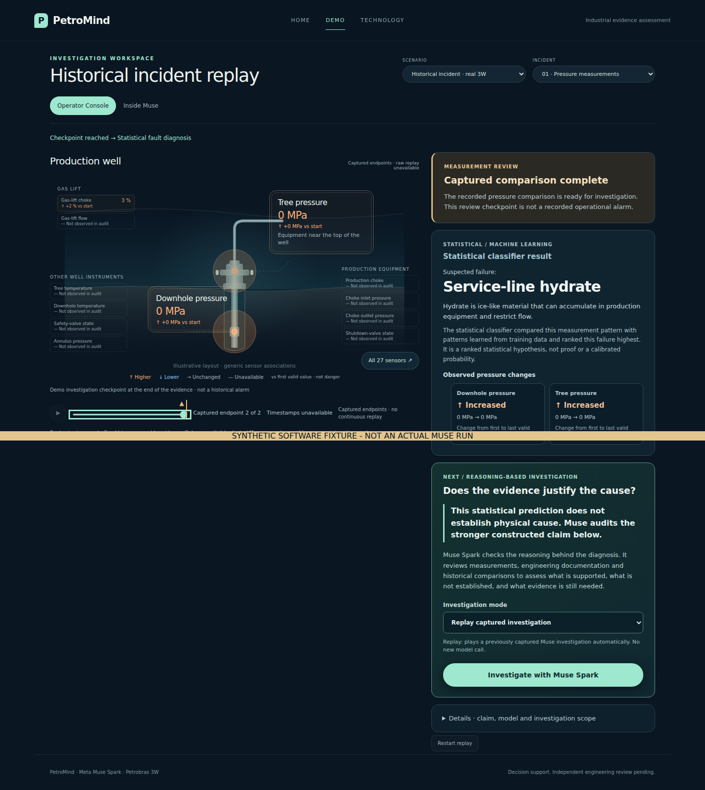
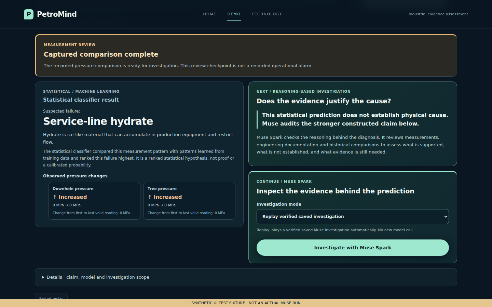
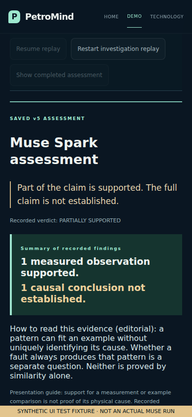

# Final hackathon sprint: judge walkthrough and verification

This sprint focuses on the product a judge sees. Research, scorer/reference
material, recorded findings, model prompts, budgets and diagnostic semantics are
unchanged. PR #36 is not merged or used by this branch.

## Priorities found in the rendered app

| Priority | Finding | Result |
| --- | --- | --- |
| P0 | A first-time viewer had to discover timeline scrubbing and the diagnosis gate. | Guided stages and explicit recorded-alert / classifier jumps. Existing evidence and anomaly gates remain enforced. |
| P0 | The classifier/Muse transition was a long narrow stack; the action was far below the classifier. | Four cards: alert, classifier, why investigate, continue. Desktop groups the explanation and launch beside the classifier; mobile preserves DOM order. Technical details remain a separate disclosure. |
| P0 | Investigation context required reading a long event feed. | A clearly labeled claim-under-review and received-evidence summary sit above the actual event timeline. No private reasoning is displayed. |
| P1 | Pressure movement required opening a sensor dialog. | Two small traces show only values up to the current playback position, with gaps preserved. Endpoint-only captures show unconnected points. |
| P1 | Final output repeated the full assessment in several places. | Scoped payoff stays prominent; full receipt and original returned statements are expandable and unchanged. |
| P1 | Replay request origin could be labeled as a live request. | Recorded request labels now apply to both replay modes. Replay/live identity stays visible in the walkthrough. |
| P2 | An unavailable synthetic scenario was selectable. | Disabled that option; no new scenario or research infrastructure was added. |

## Complete judge walkthrough

1. Open Home and choose **Explore the investigation**. Explain that industrial
   patterns can have multiple causes.
2. Begin Demo with the first recorded position. The scene describes a production
   well; sensor labels and units distinguish measured values from interpretation.
3. With the authorized monitoring bundle, use **Jump to recorded alert**. An alert
   identifies deviation, not root cause. Use **Continue to classifier** to navigate
   to the original completed evidence window. A jump never runs a model or adds
   evidence. With only the capture, the UI correctly shows two endpoints and a
   review checkpoint instead of inventing a continuous monitor.
4. Read the four handoff cards. The statistical score bars use the captured
   rankings, not calibrated probabilities or invented sensor attributions. The
   cause asserted in the audit is a stronger constructed claim, not an operator
   diagnosis or a causal explanation supplied by the classifier.
5. Select the recorded investigation mode. Click **Investigate with Muse Spark**.
   Keep the replay disclosure visible. Pause/resume if needed; the claim and
   evidence counts describe only revealed records.
6. Inspect a returned source in the evidence map. Documented topic relationships
   are not verified piping in this well. Historical similarity is not causal proof.
7. Let the replay finish. Read the sensor/documentation/causal sections and expand
   one exact finding, citation and missing premise. **Read the findings** provides
   an explicit route to the payoff. Restart hides unrevealed findings again.
8. Visit Technology for implementation and unchanged benchmark context. Browser
   Back returns to the in-memory investigation state. A full reload starts a new
   viewer session, without changing a capture or starting a paid run.

## Verification scope

The baseline suite passed 630 tests, with one optional browser test skipped.
The final receipt is recorded below after execution. All live behavior exercised
in this sprint used mocked HTTP responses; no real Meta call occurred.

- The **original claim-audit archive** was recovered and passed the loader's fixed
  protocol/result digest checks. Both actual captured cases were exercised through
  Home → endpoint comparison → classifier → recorded tools/source inspection →
  final accepted findings on desktop/mobile. These are genuine original v1
  recordings, **not the successful saved v5 run**.
- Full monitoring transitions and the saved-v5 browser journey were tested with
  explicitly labeled **synthetic software fixtures**. They are not industrial
  telemetry or evidence of paid API connectivity.
- The actual full monitoring bundle, original raw 3W files and saved v5 artifacts
  were unavailable. This sprint cannot certify their end-to-end execution here.
  Complete the local commands below before recording the final submission.
- Existing errors, source integrity, missing measurements, budget/repair contracts
  and mocked live success/failure/additional-sensor paths are exercised without
  weakening safeguards or substituting replay after a failure.

## Run locally against the real bundles

Stop the old local server first. Keep any existing imported saved-run argument:

```bash
python -m pip install -e '.[test,agent,audit]'
python -m pytest -q
python scripts/demo_claim_audit.py check \
  --capture .petromind/claim-audit-v1 \
  --dataset ../3W/dataset \
  --science-protocol .petromind/science-m5-v1/protocol.json \
  --monitoring .petromind/monitoring-demo-v1
python scripts/demo_claim_audit.py serve \
  --capture .petromind/claim-audit-v1 \
  --dataset ../3W/dataset \
  --science-protocol .petromind/science-m5-v1/protocol.json \
  --monitoring .petromind/monitoring-demo-v1
```

Open `http://127.0.0.1:8765/demo`, hard-refresh, and follow the walkthrough. If you
already imported the real v5 run, append `--saved-run .petromind/judge-v5-replay-v1`
(or your actual verified directory). Do not recreate or edit live006/live007.
Neither command above authorizes paid calls. No `--enable-live` is needed to judge
or record the replay.

For repeatable browser verification, install Playwright/Chromium in the testing
environment, then run:

```bash
PETROMIND_BROWSER_CHECK=1 python -m pytest -q
python scripts/check_claim_demo_browser.py --url http://127.0.0.1:8765
python scripts/verify_monitoring_browser.py \
  --capture .petromind/claim-audit-v1 \
  --monitoring .petromind/monitoring-demo-v1
```

Set `PETROMIND_CHROMIUM=/absolute/path/to/chromium` for the opt-in pytest tests
when using a custom installed browser. The standalone checker accepts
`--browser /absolute/path/to/chromium`. All browser commands above are zero-paid.
New walkthrough tests capture **watermarked synthetic UI screenshots only**.

## Submission assets and remaining work

- [Architecture and data flow](architecture.md)
- [Video script, shot list and fallback narration](hackathon-demo.md)
- [Project description and short portal copy](hackathon-submission.md)
- [Official requirements, deadlines and owner checklist](submission-checklist.md)

Remaining submission work: run the real full-monitoring/saved-v5 walkthrough on
the owner's machine; verify judge access to a supported demo; inspect the
signed-in portal's exact fields/video limits; record and export the final video;
submit and retain its receipt. No hosted/public demo, completed video, submitted
entry, verified physical cause or new research result is claimed by this PR.

## Final execution receipt

| Check | Result |
| --- | --- |
| Full suite with Chromium opt-in enabled | **634 passed; 14 subtests passed** |
| Original captured browser journey | Both cases, desktop 1440×900 and mobile 390×844; three pages; **0 JavaScript errors, 0 paid requests** |
| Mocked integration paths | Seven mock responses: ordinary live completion, incomplete-output failure, source-motivated additional measurement |
| New guided journey and Technology regression | Desktop 1440×900, tablet 1024×768 and mobile 390×844; labeled synthetic inputs |
| Saved-v5 replay controls | Existing 24-test module passed with Chromium enabled; synthetic saved run, not the owner's actual v5 record |
| Source capture preservation | Extracted protocol/results remain byte-identical to the supplied archive after browser execution |
| Python lint, JavaScript syntax, diff whitespace | Passed for changed files |
| Paid connectivity / original raw data / actual saved-v5 verification | Not performed; no paid calls, full raw dataset, monitoring bundle or actual v5 run available |

Capture SHA-256 after verification:

```text
protocol.json  9693119ed1ca2919043b58f612f33e9af74ac401d5a364eff79db19e2f09f6ed
results.jsonl  25ae759bb07aa23889aefc43068a1c7eb54154007701c50b5ab3dcc36fa99422
```

Original captured screenshots and watermarked synthetic UI screenshots are
separate in the delivered screenshot bundle. Synthetic screenshots are software
layout evidence, not model-performance or physical-correctness evidence. No
private reviewer material or target labels are included.

## Layout evidence (synthetic UI fixtures)

These screenshots demonstrate presentation only. Every image is watermarked;
they must not be used as evidence of a real Muse run or physical validation.
The before image shows the original long handoff; the after image shows the
four-card arrangement with the causal boundary and action alongside the classifier.

| Before | After |
| --- | --- |
|  |  |


