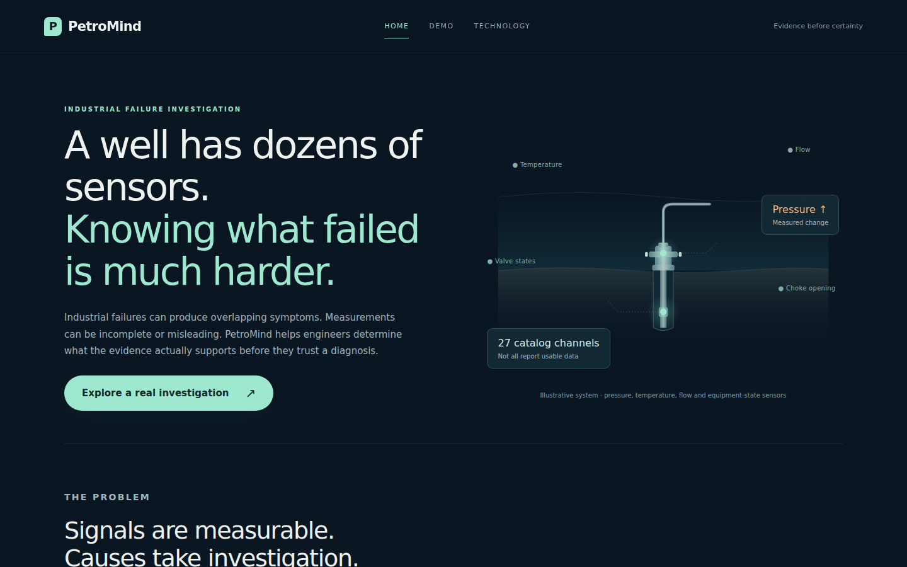
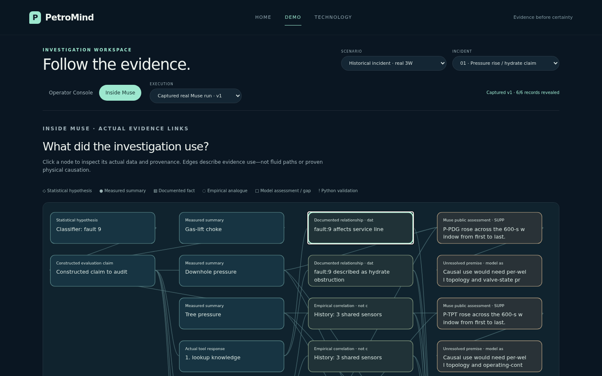
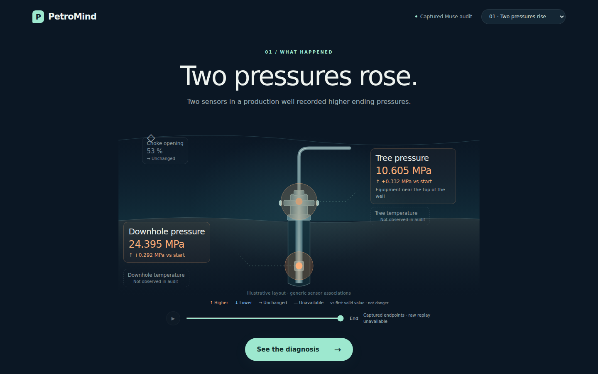
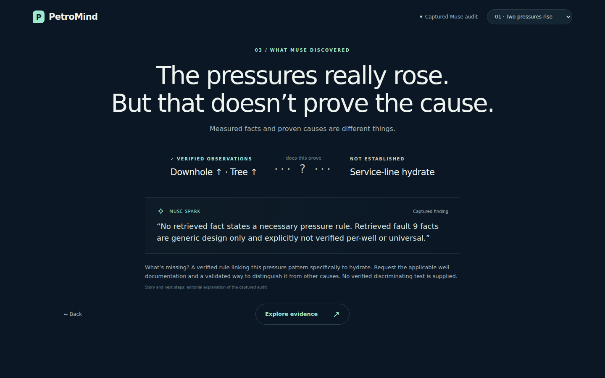
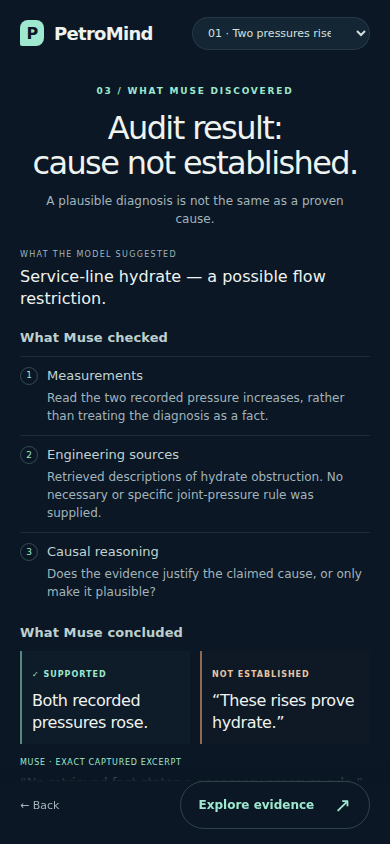
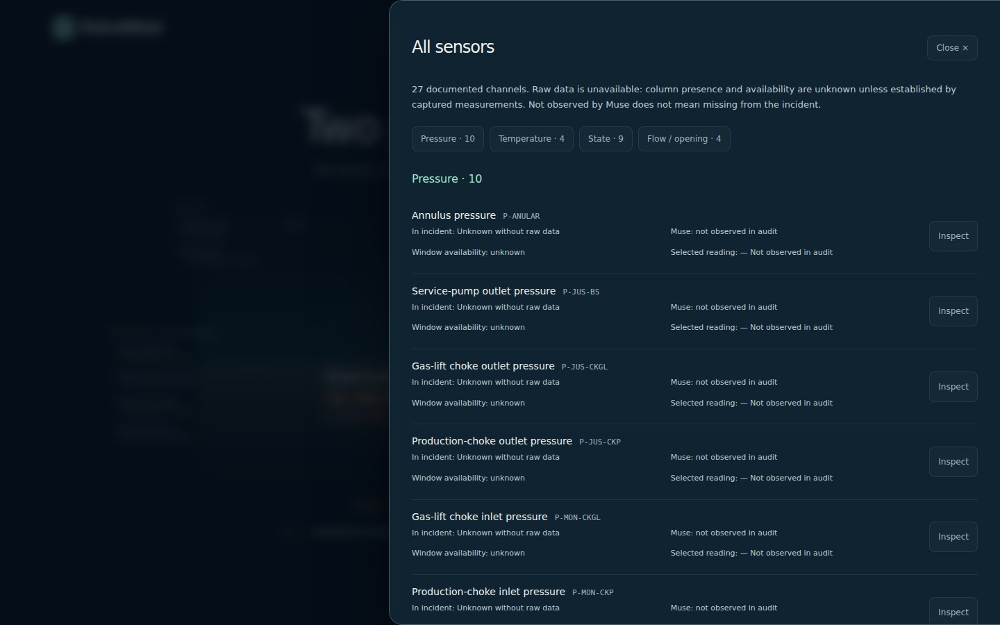

# Current three-page product screenshots

Actual Chromium viewport captures at **1440×900** and **390×844**, converted to
lossless WebP. All model activity shown here is genuine **captured replay**. No
mocked live responses or synthetic sensor fixtures appear in these images. The
raw dataset is absent here; Operator Console honestly shows actual endpoints
with Play disabled. Old iteration images remain below for traceability.

| Page / view | Desktop | Mobile |
|---|---|---|
| Home | [View](platform-home-desktop.webp) | [View](platform-home-mobile.webp) |
| Demo: Operator Console | [View](platform-operator-desktop.webp) | [View](platform-operator-mobile.webp) |
| Demo: Inside Muse | [View](platform-inside-muse-desktop.webp) | [View](platform-inside-muse-mobile.webp) |
| Technology | [View](platform-technology-desktop.webp) | [View](platform-technology-mobile.webp) |

Visual review checked hierarchy, navigation, readable instrument grouping, source
scope and evidence-graph interaction. Mobile content stacks and scrolls; the graph
pans inside its own container rather than expanding the page. Exact nodes are
inspectable, not a fabricated private reasoning transcript. Only real returned
facts and empirical matches are linked. The synthetic mode is explicitly deferred.

Validation: **368 pytest tests passed**. Browser checks exercised all three pages,
both historical captures, preserved case/cursor state between views, full inventory,
exact captured-output equality, replay events, graph inspection and raw-widget gaps.
A separate real server/runner/client test with mocked HTTP responses verified that
a first tool event reached the browser and graph before the next response was
released. It made two mocked responses and **zero paid requests**, with no mock
screenshots. This is software validation, not a new live efficacy result or a
20-second user comprehension study.

Full scope, run commands and limitations: [platform-demo.md](../platform-demo.md).

---

# Prior interface iteration

# Three scenes, two clicks

Actual Chromium screenshots at **1440×900** and **390×844**. All images are
viewport captures, not stitched scrolling pages. Lossless WebP conversion retains
the screenshot pixels. They show the genuine captured audits and actual endpoint
summaries; the raw dataset was unavailable here. No synthetic raw data appears.

| Story | Desktop | Mobile |
|---|---|---|
| Two sensors, one observed change | [Scene 1](well-desktop.webp) | [Scene 1](well-mobile.webp) |
| The plausible diagnosis | [Scene 2](diagnosis-desktop.webp) | [Scene 2](diagnosis-mobile.webp) |
| Muse finds the unsupported causal premise | [Scene 3](verdict-desktop.webp) | [Scene 3](verdict-mobile.webp) |
| Second case: example match, not root-cause proof | [Verdict](comparison-desktop.webp) | [Verdict](comparison-mobile.webp) |

Visual review: the three-scene layout is retained. The illustration now contains
12 indicators (2 primary, 10 grouped secondary), with all 27 channels in the
optional inventory. Pressure values, signed changes,
and warm/cool marker states now make scrubbing visible. Two pressures remain
primary; secondary functional groups cover temperature, state, flow, opening and
additional pressure channels. Unobserved indicators acquire values only when
verified raw data supplies them, explicitly as viewer-only telemetry. No chart appears by default.
The diagnosis explains the measurements, proposed restriction and conditional
plausibility. Muse’s result has four explicit sections: model suggestion, three checks,
supported versus unestablished conclusions, and needed evidence, with an exact
captured excerpt. Full outputs remain in
**Explore evidence**.

Compare actual endpoints: [start — desktop](replay-start-desktop.webp) →
[end — desktop](well-desktop.webp), or [start — mobile](replay-start-mobile.webp) →
[end — mobile](well-mobile.webp). Gray starts become orange higher readings in
this case; the second case also includes a blue lower reading. Colors do not
encode danger. These are real captured endpoint values, not intermediate samples.

See the [exact change inventory and boundaries](../instrument-landscape.md).

Both cases were visually reviewed on desktop/mobile. Browser assertions separately
check that all three desktop scenes fit without scrolling, the main actions remain
in view on mobile, no horizontal scrolling occurs, and closing evidence restores
keyboard focus. This is not a measured 30-second user comprehension study.

The illustration is explanatory, not verified individual-well geometry. Sensor
colors/arrows indicate change from the first valid value, not danger. No raw
dataset, evaluator labels, private protocol or credentials are included.

## Optional inventory and mobile follow-up

- [All 27 sensors — desktop](all-sensors-desktop.webp): four groups, presence,
  availability and whether Muse received the channel. Unknown presence is honest
  in this capture-only workspace.
- [Mobile verdict after scrolling](verdict-mobile-next.webp): follow-up evidence
  and scope. Mobile result content stacks vertically; the main action stays easy
  to reach.

