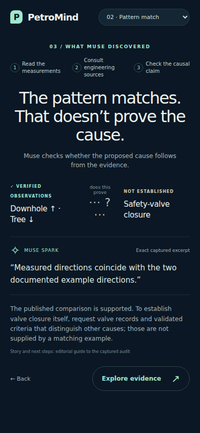

# Guided investigation screenshots

Captured with Chromium at **1440×900** and **390×844** viewports. Some images
include the full scrollable page. These use the genuine captured audits and
**actual endpoint summaries**, with no local raw dataset. They do not depict a
continuous replay or synthetic measurements. Play is disabled honestly.

- [Well and diagnosis — desktop](well-desktop.webp)
- [Fault-9 verdict — desktop](verdict-desktop.webp)
- [Well — mobile](well-mobile.webp)
- [Published comparison — desktop](comparison-desktop.webp)
- [Published comparison — mobile](comparison-mobile.webp)

The diagram is our explanatory illustration; routing/depth/placement are not
verified per-well geometry. Pressure colors indicate change from the first valid
value, not danger. The figures contain derived display summaries, not a committed
dataset, original raw telemetry, evaluator labels or private protocol files.
