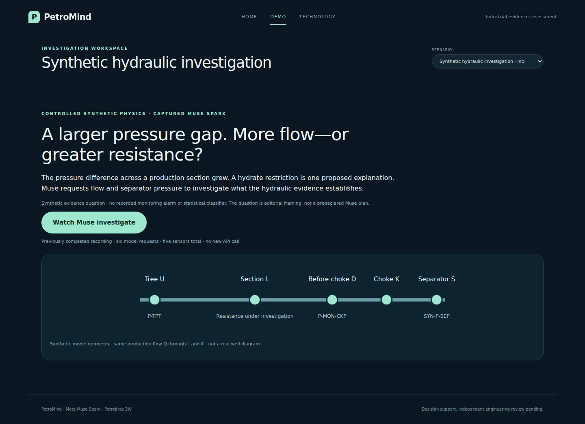
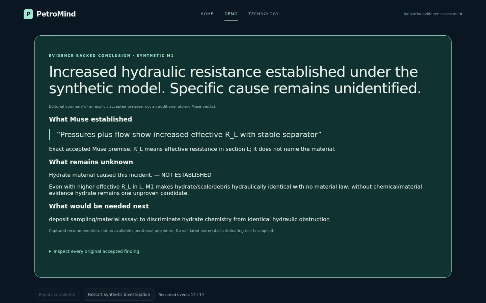
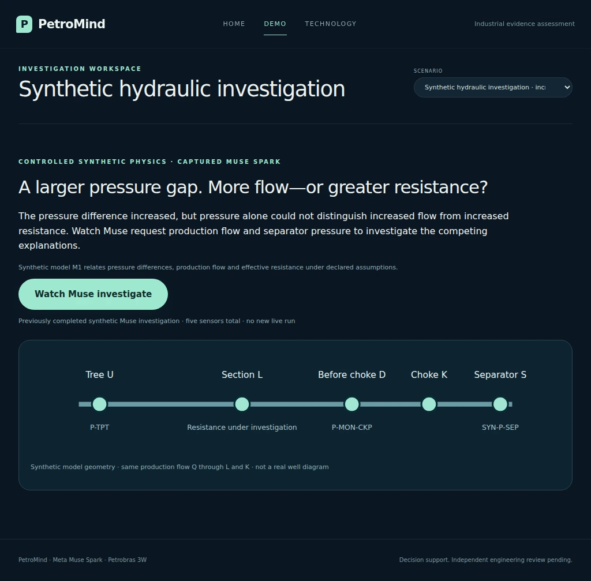
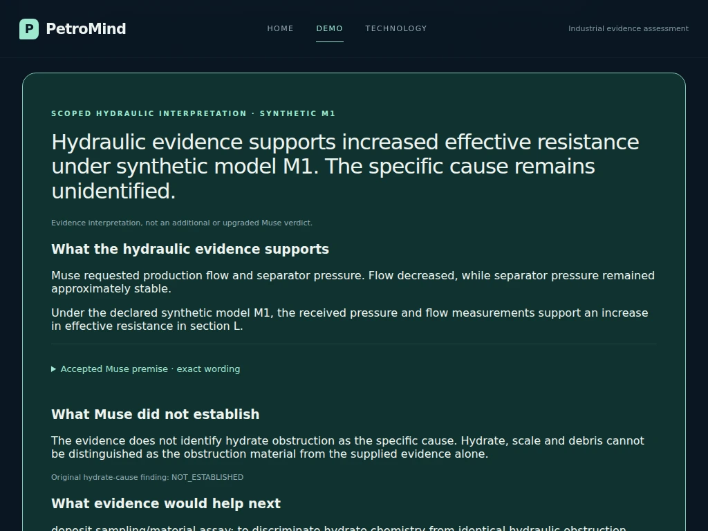
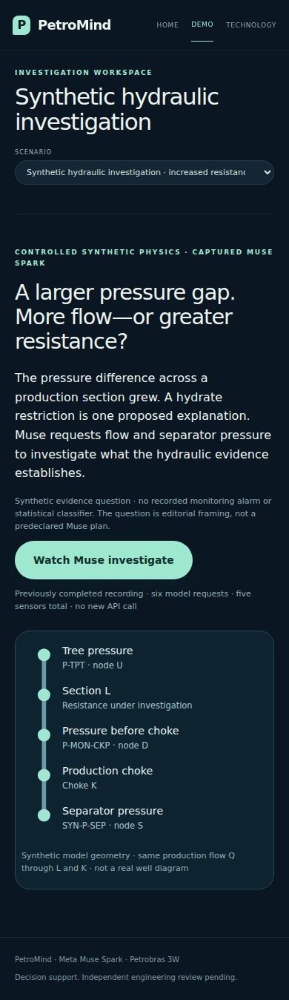
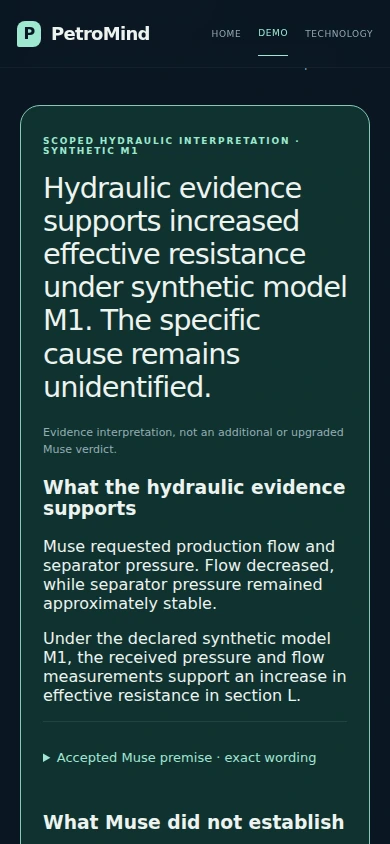

# Second demo scenario: synthetic hydraulic investigation

This optional, read-only scenario replays the verified c-7a91 Muse recording. It
uses `synthetic-hydraulic-replay-v1`, not the historical saved-v5 contract. It
never executes a model call, imports a reference key, or invents a detector or
classifier stage. Home / Demo / Technology remain the only pages.

## Run locally (macOS)

Check out this PR's `demo/synthetic-hydraulic-replay` branch. It is based on
main including the owner's merged PR #38 and PR #39. Its existing findings,
evidence controls and slider-stability behavior are preserved. Neither PR was
modified or merged by this task.

```bash
source .venv312/bin/activate
python -m pip install -e '.[test,agent]'
```

Download **PetroMind-Synthetic-Showcase.zip**, the unchanged package from the
previous handoff. Extract it locally. Do not put recordings or private evaluator
materials in Git. The nested directory contains `MANIFEST.json` and the original
host audit. For example, extract under `.petromind/` so that it contains
`.petromind/PetroMind-Synthetic-Showcase/MANIFEST.json`.

```bash
python .petromind/PetroMind-Synthetic-Showcase/verify_package.py

python scripts/demo_claim_audit.py check \
  --capture .petromind/claim-audit-v1 \
  --dataset ../3W/dataset \
  --science-protocol .petromind/science-m5-v1/protocol.json \
  --monitoring .petromind/monitoring-demo-v1 \
  --synthetic-replay .petromind/PetroMind-Synthetic-Showcase

python scripts/demo_claim_audit.py serve \
  --capture .petromind/claim-audit-v1 \
  --dataset ../3W/dataset \
  --science-protocol .petromind/science-m5-v1/protocol.json \
  --monitoring .petromind/monitoring-demo-v1 \
  --saved-run .petromind/judge-v5-replay-v1 \
  --synthetic-replay .petromind/PetroMind-Synthetic-Showcase
```

Open <http://127.0.0.1:8765/demo>. Keep your existing verified `--saved-run` path;
omit that option if no saved-v5 bundle is installed. Historical prerequisites
and validation are unchanged. The synthetic recording itself needs no dataset,
API key or fresh live protocol. Do not add `--enable-live` to run this replay. Existing live protocols retain
their source-code commitment checks; a new checkout requires a fresh live
protocol if you separately choose to enable live execution later.

The selector enables **Synthetic hydraulic investigation · increased resistance**
only when the package passes validation. Select it and click **Watch Muse
investigate**. Events advance automatically; pause, resume and restart are local
replay actions. Switching away stops the replay clock and leaves historical
records and model configuration unchanged. Switching back preserves the synthetic
cursor, paused; restart explicitly begins at the original initial evidence.

If any source is modified or absent, startup fails closed. Do not repair the
manifest to get past validation: retrieve the original package. If you cannot
install it in time, retain the standalone video package as the fallback.

## What the viewer sees

The introduction gives the hydraulic question instead of an invented monitoring
alarm or trained-classifier prediction. The original handoff's candidate and
claim remain in the received evidence; its constructed score is not presented
as a trained prediction or calibrated probability.

1. Three initial channels: P-TPT (tree pressure), P-MON-CKP (pressure before the
   choke), T-TPT (tree temperature), plus the already supplied governing M1.
2. Actual `query_sensor(SYN-Q-PROD)` request/result; production flow falls.
3. Actual `query_sensor(SYN-P-SEP)` request/result; separator pressure is
   approximately stable.
4. Actual `lookup_graph(candidate:hydrate)`; the bridge supplies depth 1. Do not
   attribute that depth choice to Muse.
5. Actual `read_document(doc:limits)` and `read_document(doc:phase)`.
6. Actual accepted `submit_audit`, followed by recorded completion.

The UI event stream adds separate request/result display records for genuine
calls; it does not add scientific activity. All per-event timestamps are
explicitly unavailable. Its fixed 1.8-second pacing is editorial, not original
wall-clock playback. The original six-request run took 62.58 seconds.

The final headline is:

> Hydraulic evidence supports increased effective resistance under synthetic model M1. The specific cause remains unidentified.

This is a **scoped editorial evidence interpretation**, not a new or upgraded
atomic Muse verdict. The final panel separates:

1. **What the hydraulic evidence supports:** Muse requested production flow and
   separator pressure; flow fell and separator pressure remained approximately
   stable. Under M1, the received pressures and flow support increased effective
   resistance in section L.
2. **What Muse did not establish:** the supplied evidence does not distinguish
   hydrate, scale or debris as the obstruction material. The accepted hydrate-cause
   finding remains NOT_ESTABLISHED.
3. **What evidence would help next:** the exact recorded deposit sampling/material
   assay request, explicitly described as an evidence category, not a validated
   field procedure.
4. **Exact scientific assessment:** the unchanged aggregate PARTIALLY_SUPPORTED,
   every original atomic finding, verdict, premise, citation and numeric observation.

The exact accepted premise, available in its own disclosure, is:
“Pressures plus flow show increased effective R_L with stable separator.”
The plain-language interpretation is not substituted for this quotation. No
SUPPORTED resistance atom is added. The separately calculated 2.41–2.59× interval
remains omitted from the UI; it is not attributed to Muse.

## Evidence and integrity boundaries

- Pin the original package manifest and original host-audit SHA-256. Validate all
  nine committed files without executing any supplied Python or HTML.
- Verify host chain, initial packet, fixed event order, requested/applied
  arguments, accepted output and the exact five distinct channels.
- Read only known source files, reject duplicate/nonfinite JSON, symlinked
  files, oversized files, unknown manifests and modified recordings.
- Project received measurements, public M1 assumptions, returned graph edges,
  source-scoped summaries and accepted findings. Never read a sensor vault,
  reference key, scores, blinded review packets or original model reasoning.
- Preserve graph epistemic status and scope. Candidate edges are hypotheses;
  synthetic model assumptions are not verified installed-well topology.
- Source buttons reveal exact received objects. Graph relationships are actual
  returned triples; citation links represent citation, not physical entailment.
- GOOD endpoint summaries and plots are explicitly Python display computations.
  Original quality flags, missing values and raw units remain available. Zero
  and constant GOOD samples remain valid. No interpolated samples are created.
- New sensors appear in the replay only after their original returned event.
  This recording does not establish graph-guided acquisition: graph lookup
  happened after the two new sensor requests.
- Missing chemistry/phase evidence stays missing. Sampling/assay is a captured
  recommendation category, not an available validated procedure or safety advice.
- Showcase selection was post hoc; no accuracy estimate or causal intervention
  benefit is claimed. No qualified independent human physical review is implied.

## Offline and browser verification

```bash
python -m pytest -q
python -m pip install playwright
python -m playwright install chromium

PETROMIND_BROWSER_CHECK=1 \
PETROMIND_SYNTHETIC_SHOWCASE="$PWD/.petromind/PetroMind-Synthetic-Showcase" \
PETROMIND_SCREENSHOTS=/tmp/petromind-synthetic-screenshots \
python -m pytest -q tests/test_synthetic_replay.py
```

The browser test uses the actual supplied synthetic recording when that variable
is set; the historical capture is an explicitly artificial software fixture.
Without the variable, adapter/browser tests use an artificial synthetic software
fixture too. No fixture result is represented as a model execution.

Manual checks: desktop 1440×900 and mobile 390×844; select scenario, begin, observe
three → four → five sensors, inspect the source/model buttons, finish, inspect
all original findings, restart, return to historical. No horizontal page
scrolling, no live request, no classifier prediction in the synthetic workspace.
Use the owner's unchanged historical inputs to verify the actual local 3W and
saved-v5 journeys separately. Browser fixture regression is not verification of
private datasets that are unavailable in the implementation environment.

## 75-second walkthrough

- 0–15 s: “This second scenario is synthetic. A pressure gap grows. More flow and
  greater resistance are competing hydraulic explanations under the supplied
  model; hydrate is only a material hypothesis.”
- 15–35 s: Start replay. “Muse requests production flow and separator pressure.
  Flow falls, rather than rises. These are the actual returned samples.”
- 35–50 s: Inspect M1 and the returned graph/documents. “The governing relation
  links pressure difference to resistance times flow squared. The source scopes
  also tell us what these hydraulics cannot identify.”
- 50–75 s: Show final findings. “The hydraulic evidence supports greater
  effective resistance under M1. That is the scoped interpretation of an accepted
  Muse premise—not a new positive atomic verdict. The material remains unidentified.”

Do not say Muse predeclared this experiment, graph context selected the sensors,
this is Petrobras telemetry, or a material/root cause was proved. If anything
fails, use the unchanged standalone captured video segment and label it as
previously recorded activity; never fake a live response.

## Final integration verification receipt

- Integrated main **357e674a04991391e49622a00cf585bdf9428f48**, including PR #39.
  Three-way app.js merge completed without textual conflicts; preserve the explicit
  scroll opt-in, stable sample-counter widths and removal of stage-dependent grid
  reordering. Incoming style.css and slider regression tests are unchanged from main.
- Final isolated checkout of merged main (including PR #38 and PR #39) plus this feature,
  with Chromium and the unchanged owner-supplied synthetic package:
  **661 tests passed, 14 subtests passed; no skipped tests** (113.72 seconds).
  Targeted synthetic and PR #39 pointer-drag regressions: **13 passed**.
- Actual synthetic package: nine source commitments, original seven-entry host
  chain, five charged sensors and exact final accepted assessment verified.
- Desktop 1440×900, tablet 1024×768 and mobile 390×844: actual synthetic replay, three → four → five
  received sensors, six tool requests, source inspection, no page overflow,
  completion, pause/resume/restart, exact-assessment equality, historical/synthetic
  switching, no JavaScript errors and no
  paid requests.
- Existing historical browser journeys pass with software fixtures. The owner's
  actual 3W dataset, monitoring bundle and saved-v5 run are not present here.
- Ruff checks, Python formatting, both JavaScript syntax checks and whitespace
  checks pass. Scientific captures, frozen experiments and PR #38 remain unchanged.

### Browser screenshots

Actual supplied synthetic recording; no generated model responses:







