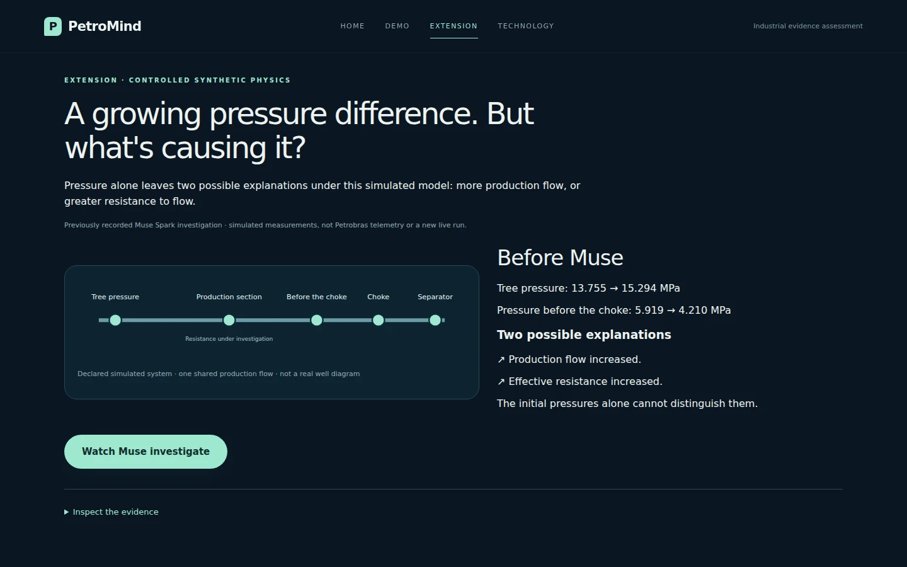
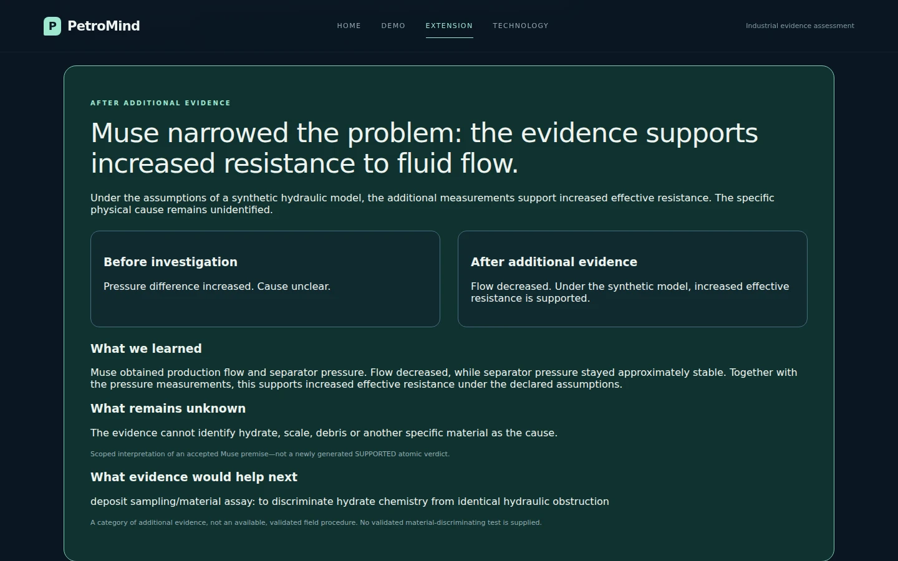

# Extension: a synthetic hydraulic investigation

Navigation: **HOME | DEMO | EXTENSION | TECHNOLOGY**.

`/demo` remains dedicated to the historical Petrobras 3W investigation, including
PR #38 findings controls and PR #39 slider stability. Synthetic playback is no
longer a Demo selector option. `/extension` has its own narrative in the same
application, with shared navigation, theme, typography and controls. Direct
navigation and refresh work.

## Run locally

Use merged `main` and your existing verified replay artifacts:

```bash
git fetch origin
git switch main
git pull --ff-only origin main
source .venv312/bin/activate

python scripts/demo_claim_audit.py serve \
  --capture .petromind/claim-audit-v1 \
  --dataset ../3W/dataset \
  --science-protocol .petromind/science-m5-v1/protocol.json \
  --monitoring .petromind/monitoring-demo-v1 \
  --saved-run .petromind/judge-v5-replay-v1 \
  --synthetic-replay .petromind/PetroMind-Synthetic-Showcase
```

Keep your actual verified `--saved-run` path; omit that argument if no saved-v5
bundle is installed. The unchanged showcase ZIP must be extracted so the last
directory contains `MANIFEST.json`. Do not regenerate its commitments or commit
recordings/private evaluator materials. No API key or live enablement is needed
for Extension. Historical startup prerequisites remain unchanged.

- Historical Demo: <http://127.0.0.1:8765/demo>
- Synthetic Extension: <http://127.0.0.1:8765/extension>

## The story

1. **The mystery:** a growing pressure difference, with two possible explanations
   under the declared simulated model: greater production flow or greater effective
   resistance. Only the initial received pressures are shown.
2. **Muse investigates:** the actual production-flow request/result, then separator
   pressure request/result, then returned graph/document context, then the accepted
   assessment. Received readings appear only after their original result event.
3. **Before/after conclusion:** flow fell while separator pressure remained
   approximately stable. The additional measurements support greater effective
   resistance under the supplied model, but not an obstruction material identity.
4. **Inspect the evidence:** one collapsed disclosure contains original measurements,
   graph relationships, engineering model/documents, actual requests/results and
   the exact accepted assessment. The graph is never shown by default at completion.

Headline:

> Muse narrowed the problem: the evidence supports increased resistance to fluid flow.

Supporting conclusion:

> Under the assumptions of a synthetic hydraulic model, the additional measurements support increased effective resistance. The specific physical cause remains unidentified.

This is a scoped interpretation of the accepted premise, not a new SUPPORTED
atomic verdict. Exact technical details retain aggregate PARTIALLY_SUPPORTED and
hydrate-cause NOT_ESTABLISHED, all original premises, citations and numbers.
Sampling/material assay remains a category of additional evidence, not an
available validated field procedure.

The scenario is controlled synthetic physics and previously recorded Muse activity,
not Petrobras measurements, a historical alarm, trained classifier output or a live
execution. The initial competing-explanation framing is editorial, not a recorded
predeclared experiment. Graph retrieval followed sensor acquisition. Playback
pacing is editorial; individual call timestamps were not captured. The resistance
interval is not displayed or attributed to Muse.

## Integrity and focused verification

The separate `synthetic-hydraulic-replay-v1` adapter is unchanged in this UX pivot.
Original package commitments, host chain, six requests, five distinct sensors,
request/result ordering, accepted output and provenance remain intact. No hidden
sensor vault, evaluator key, new physical relationships or paid calls are used.

```bash
python .petromind/PetroMind-Synthetic-Showcase/verify_package.py
python -m compileall -q petromind/claim_demo.py
node --check petromind/web/app.js
node --check petromind/web/synthetic.js

# Optional one-desktop smoke using installed Playwright/Chromium:
PETROMIND_BROWSER_CHECK=1 \
PETROMIND_SYNTHETIC_SHOWCASE="$PWD/.petromind/PetroMind-Synthetic-Showcase" \
PETROMIND_SCREENSHOTS=/tmp/petromind-extension \
python -m pytest -q tests/test_synthetic_replay.py
```

Final UX-pivot checks: **11 passed in 3.92 seconds**, plus **one four-route/security-scope check passed**. This includes existing adapter
integrity checks and one desktop smoke with the genuine supplied synthetic
recording. Verified direct `/extension`, refresh, four nav links, delayed evidence
reveal, playback completion, collapsed graph, exact accepted-assessment equality,
source selection and return to historical `/demo`. Zero JavaScript errors, paid
requests or page overflow. Python/JS syntax, Ruff and whitespace checks pass.
The original package verifier passes. The full suite was deliberately not rerun
for this presentation pivot; the preceding PR #39 integration passed 661 tests
and 14 subtests. No multi-viewport automation was added.

Historical browser data in this environment is an explicit software fixture;
the owner's actual 3W/monitoring/saved-v5 artifacts remain an owner-side check.
This post-hoc showcase is not an unbiased evaluation or independent human
physical certification. Keep the unchanged standalone recorded video as fallback.

## 60-second Extension walkthrough

- 0–15 s: show the mystery and the two explanations. Identify the initial pressures.
- 15–35 s: click Watch Muse investigate. Observe the genuine flow and separator
  pressure requests/results, followed by supporting engineering context.
- 35–50 s: show the before/after conclusion. Flow fell; the model-conditional
  resistance interpretation is better supported, while material identity remains unknown.
- 50–60 s: optionally open Inspect the evidence to show exact source and assessment
  provenance. Do not lead with the technical graph or imply a new live run.

The following images preserve the PR #40 presentation before the submission-copy
cleanup; their original recorded evidence is unchanged.



